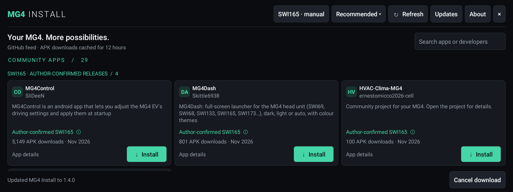
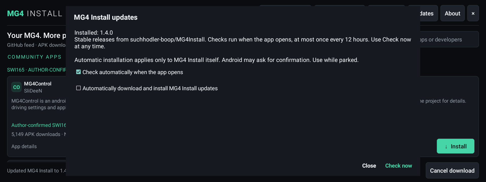

# MG4 Install

A fullscreen Android app catalog and installer for compatible MG4 head units.
Browse large app cards, read project information inside the app, and download
APKs directly into Android’s installer without finding them in Downloads.

**[Download the latest release](https://github.com/suchhodler-boop/MG4Install/releases/latest)**



## Catalog

The app refreshes [hojnikb’s MG4 Apps list](https://github.com/stars/hojnikb/lists/mg4-apps)
and always includes [MG4Zorst](https://github.com/suchhodler-boop/MG4Zorst) and
[MG4WirelessADP](https://github.com/suchhodler-boop/MG4WirelessADP). Repository
names are deduplicated without regard to capitalization, so adding either to
the upstream list does not create another card. Supplemental apps are also
present when browsing the saved feed offline.

- Live GitHub descriptions, stable APK releases and download counts; optional prereleases.
- Search, recommended order, download-count order and recently-updated order.
- Compatibility groups come first in every sort mode. SWI165 support is based
  on reviewed README/release-note evidence, never names alone. See [the review](COMPATIBILITY.md).
- Automatic SWI detection with a visible manual override. Compatibility is
  advisory: unverified or incompatible apps show **Install anyway**, not a block.
- In-app README/release-note reader and large dark dialogs.
- APKs published directly in repositories are supported when no eligible
  release APK exists. Reference projects retain their source information.

GitHub’s public list HTML is parsed because public star-list membership is not
available through its REST API. Layout changes or outages preserve the saved
feed. Unauthenticated GitHub API rate limits apply. APK download counts cover
up to 100 releases, include prereleases, and are cached for 12 hours. A `+`
marks a lower bound; downloads are not unique users or a compatibility rating.

## Install and use

Install `MG4-Install-1.4.0-car.apk` once on the head unit. Use while parked.
Tap **Install**, choose a variant if more than one exists, then continue through
the compatibility warning. The app downloads, checks and submits the APK to
Android’s PackageInstaller. Download/installation failures are displayed.

The car build uses `android.uid.system` and the public AOSP platform test
certificate, following MG4Dash. It requires firmware that accepts that
certificate. Android still enforces certificate, version, ABI and SDK rules.
Unknown firmware does not prevent proceeding through the warning.

The app uses immersive fullscreen and requests the OEM dock to hide while it
is open, restoring it when leaving. Firmware-specific dock behavior needs
verification on the car. Emulator checks do not establish vehicle compatibility.

## MG4 Install updates

Open **Updates** for the installed version, **Check now** and update settings.

- Automatic checks are enabled by default. They run when the app opens, at
  most once every 12 hours after a successful check.
- **Automatically download and install MG4 Install updates** is optional and
  off by default. When enabled, a newer stable release is installed while the
  app is open, provided another download is not running. Otherwise use **Update now**.
- Updates come only from this repository’s latest non-prerelease GitHub release.
  Checksums, published asset metadata, package identity, a strictly newer Android
  version code and the installed signing certificate are checked before commit.
- Android may require confirmation. The app can close as it replaces itself;
  reopen it afterwards. Preferences are retained by the normal Android upgrade.
- This updates **MG4 Install itself**, not other catalog apps automatically.
  No background daemon runs when the app is closed. Emulator builds never
  accept the car APK as a self-update.



## Build

Requires PowerShell, Android SDK platform 34/build-tools 36.0.0 and JDK 17+.
No Gradle or third-party Java library download is needed. Intermediates, APKs
and task caches stay inside the project.

```powershell
# Obtain the public AOSP platform test certificate/key; never use a private key in Git.
.\setup-public-test-keys.ps1
.\test.ps1 -Jdk 'E:\Tools\jdk-17'
.\build.ps1 -Sdk 'E:\Android\Sdk' -Jdk 'E:\Tools\jdk-17'
.\prepare-release.ps1
```

`build.ps1 -Emulator` produces a separate package without the system UID for
desktop validation. Build and signing paths are configurable. Keys, SDKs,
build directories and scratch files are excluded from Git.

For each release, increase `versionCode` and `versionName` in
`AndroidManifest.xml`, build and verify, then run `prepare-release.ps1`.
Publish a stable `v<versionName>` tag with the car APK, generated `update.json`,
`SHA256SUMS.txt` and corresponding source ZIP. Publish all assets together;
the updater expects exactly that tag, version and APK metadata. Preserve the
signing certificate across releases. Build output may vary with tool versions
and archive timestamps.

## License and attribution

Copyright (C) 2026 MG4 Install contributors.

**GNU General Public License, version 3 only (`GPL-3.0-only`).** See [LICENSE](LICENSE)
and [NOTICE](NOTICE). The full license is also available offline under About.
This software is distributed without warranty.

The PackageInstaller flow is adapted from [MG4Dash](https://github.com/Skittle6938/MG4Dash)
(GPL-3.0). Firmware detection uses the MIT-licensed MG4Control v2.6.5 method;
its original notice is preserved in [MG4Control-LICENSE.MIT](MG4Control-LICENSE.MIT).
See [THIRD_PARTY.md](THIRD_PARTY.md). Catalog applications retain their own licenses.
This is an independent community project, not an official MG or GitHub app.
